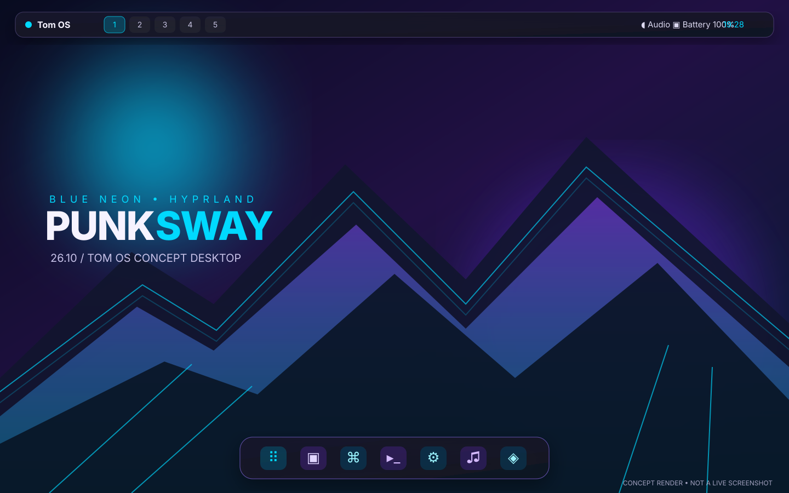
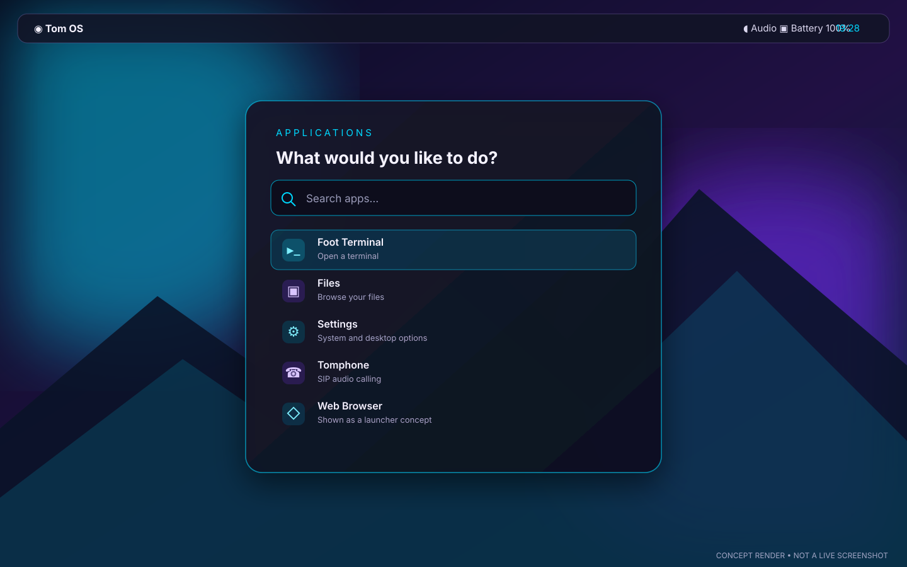

# PunkSway 26.10

**An Ubuntu-based live OS concept with a blue-neon punk aesthetic and Hyprland/Wayland as the intended desktop, with no Sway components.** The project is designed to build on an Omarchy Linux host by running the image-customisation tools inside an Ubuntu 26.10 Podman container.

> This repository contains the build project, not a prebuilt multi-gigabyte ISO. Supply the official Ubuntu base ISO; the scripts generate `dist/PunkSway-26.10-amd64.iso` locally. The source ISO is never changed.

## WordCraft word processor\n\nThe live ISO includes [WordCraft](https://github.com/storytold/wordcraft), an open-source Rust word processor. The build downloads the upstream x86_64 Ubuntu `.deb` for version 0.11.0 and verifies it against the release `SHA256SUMS.txt` before installing it into the live filesystem. A working network connection is required during the build. The release is pinned intentionally for repeatability; update `WORDCRAFT_VERSION` in `scripts/build-in-container.sh` to move to a newer release.\n\n## Plymouth boot splash

The image includes a custom Tom OS purple/cyan Plymouth theme. The build renders the splash artwork from `assets/render_plymouth.py`, installs the script theme and enables the Plymouth script plugin. The progress bar fill is resized from Plymouth boot-progress callbacks, so it reflects reported boot progress. This has been statically configured but still needs an ISO build and VM boot test.

## Base system and kernel

Tom OS/PunkSway now targets Ubuntu 26.10 (Stonking Stingray), whose official release ships Linux 7.3. The build installs the `linux-generic` metapackage and checks that a Linux 7.3 generic kernel image package is present before repacking the ISO. Ubuntu 26.10 is an interim release with support through July 2027, not an LTS release. The kernel shipped on the original release image was based on 7.3-rc6; normal Ubuntu archive updates are expected to provide subsequent kernel updates. See the [official Ubuntu 26.10 release notes](https://documentation.ubuntu.com/release-notes/26.10/).

## Install Tomphone on Ubuntu

On Ubuntu amd64, run this one-line command to download the source, build the Debian package, install its dependencies and install Tomphone:

```bash
curl -fsSL https://raw.githubusercontent.com/Spruhantom/tomos-ubuntu/main/scripts/install-tomphone.sh | sudo bash
```

The installer uses the repository's current `main` branch and requires an internet connection. It installs build tools and Baresip dependencies and compiles the package locally; this is not a prebuilt binary download. Tomphone is a SIP audio-calling application, not a phone-data transfer tool. Review `scripts/install-tomphone.sh` before running a remote script with administrator privileges.

## Display manager recovery\n\nThe live ISO explicitly sets `graphical.target`, enables SDDM, and configures SDDM to automatically log the `ubuntu` live user into `hyprland.desktop` when booted from USB. This autologin setting is written to the live filesystem only. The build disables competing display-manager services, checks that the Hyprland Wayland session exists, and verifies the `display-manager.service` alias. A recovery helper is installed as `/usr/local/sbin/fix-display-manager`; from a text console, run `sudo /usr/local/sbin/fix-display-manager` and reboot if the graphical login does not appear. This is a configuration safeguard; only a VM boot test can confirm the display stack starts successfully.\n\n## Tomphone SIP softphone

The build compiles the included Qt 6 Tomphone source and creates `build/tomphone_0.1.0_amd64.deb` inside the Ubuntu builder, then installs that package into the live filesystem. It adds a Tomphone application launcher and depends on Baresip plus Qt Quick modules and PulseAudio-compatible audio. Tomphone is a SIP audio-calling app, not a phone-data transfer utility. Package compilation and SIP/audio behaviour still need runtime testing in the built image.

## Desktop concept renders

These SVG renders illustrate the intended PunkSway blue-neon desktop design. They are **concept mockups, not screenshots captured from a built or running ISO**; the live appearance may differ until the image is built and tested.

### Hyprland desktop and floating dock



### Application launcher concept



## What's included

- Hyprland/Wayland as the only supported window manager session.
- A custom neon-blue Caelestia Shell configuration with translucent panels, rounded surfaces, five workspaces, and dynamic colours driven by the Tom OS wallpaper. Caelestia itself is not automatically built into the ISO because its Quickshell/Qt dependency versions need validation on Ubuntu 26.10; Waybar and Wofi remain as a fallback.
- Tom OS-inspired purple/neon desktop based on the supplied reference: scenic neon wallpaper, slim top panel, five workspaces, translucent floating bottom app dock, rounded dark windows and coordinated colours.
- SDDM graphical display/login manager with the Hyprland Wayland session. Hyprland is the sole supported window manager.
- A custom-branded Calamares installer configuration and launch icon, plus partitioning tools. The installer configuration is experimental until tested in a VM on both UEFI and BIOS systems.
- Zsh as the default shell, with a custom violet/cyan prompt and a Tom OS ASCII logo shown by Fastfetch on interactive terminals.
- NetworkManager tray applet, PipeWire tools, screenshots, clipboard tools, idle locking and a quick-start guide.
- Tomphone Qt 6 SIP softphone packaged as an Ubuntu `.deb` during the build.
- Build scripts to customise the live filesystem and preserve the source ISO's boot setup.

## One-line full-project ISO build

On an x86_64 Fedora, Ubuntu, Debian 12 (Bookworm), Debian 13 (Trixie), or Arch-based Linux host, this command downloads the project and the official Ubuntu 26.10 Desktop amd64 ISO, verifies the ISO checksum, and builds the complete PunkSway ISO. It installs Podman and helper tools on Fedora and Ubuntu/Debian. On Arch-based hosts, install Podman first with `sudo pacman -Syu podman` to avoid an unsafe partial package upgrade:

```bash
curl -fsSL https://raw.githubusercontent.com/Spruhantom/tomos-ubuntu/main/scripts/build-punksway-iso.sh | sudo bash
```

The build output is saved under `/var/tmp/punksway-iso-build/project/dist/`. It needs internet access and approximately 25–35 GB of free disk space, and can take a while. It creates an ISO file only; it does **not** install or replace the operating system on the host. Review `scripts/build-punksway-iso.sh` before running a remote script as root, then test the resulting ISO in a virtual machine before installing it on hardware.

## Build manually on Omarchy Linux

Install Podman:

```bash
sudo pacman -S podman
```

Download the **Ubuntu 26.10 Desktop amd64** ISO from <https://releases.ubuntu.com/26.10/>.

Run the project checks:

```bash
./check-project.sh
```

Build the ISO:

```bash
./build.sh /path/to/ubuntu-26.10-desktop-amd64.iso
```

The output and checksum are:

```text
dist/PunkSway-26.10-amd64.iso
dist/PunkSway-26.10-amd64.iso.sha256
```

**Build requirements:** x86_64 Fedora, Ubuntu, Debian 12 (Bookworm), Debian 13 (Trixie), or Arch-based Linux, internet access, Podman, and approximately 25–35 GB of free scratch space. The first build downloads the Ubuntu container image and installs the required tools inside it.

## Hyprland and Caelestia status

The project includes `config/caelestia/shell.json`, which sets a neon-blue/cyan dynamic theme, translucent layers, rounded styling, five workspaces and the Tom OS wallpaper directory. When Caelestia is installed, Hyprland starts it and requests the wallpaper-derived dynamic scheme. The project also includes `scripts/install-caelestia.sh`, which only checks out the shell source; it does not install dependencies or compile it. Follow the upstream requirements at <https://github.com/caelestia-dots/shell>, including the git version of Quickshell and `caelestia-cli`. Ubuntu 26.10 compatibility remains experimental and unverified, and the ISO does not yet include a working prebuilt Caelestia Shell.

Sway has been removed from the package list and build configuration. Test the Hyprland session in a VM before using the image on hardware.

## Visual match and current limits

The desktop aims to reproduce the reference layout using Hyprland, Waybar, Wofi and Foot. The top panel and bottom app dock are separate Waybar instances with clickable shortcuts. This is a close recreation rather than a pixel-identical copy: the Omarchy quick-settings panel and full app-grid shell are not included in this Ubuntu remix. Wofi supplies application search, and the top panel shows common status controls.

## Default shortcuts

| Shortcut | Action |
|---|---|
| `Super + Enter` | Terminal |
| `Super + D` or `Super + Space` | App launcher |
| `Super + Q` | Close window |
| `Super + F` | Fullscreen |
| `Super + H/J/K/L` | Move focus |
| `Super + Shift + L` | Lock screen |
| `Print` | Select a screenshot region |

## Test before installing

Boot the generated ISO in a virtual machine before installing it on physical hardware. Verify that the live Hyprland session, networking, audio and installer work. This project has not yet been verified by booting a generated ISO on real hardware; treat the first build as a test image and keep backups.

## Customisation

- `config/hypr/hyprland.conf`: experimental Hyprland session settings.
- `config/waybar/`: top panel, bottom dock and their styles (fallback).
- `config/caelestia/shell.json`: Caelestia neon-blue theme and shell layout.
- `config/wofi/style.css`, `config/foot/foot.ini`, `config/mako/config`: application styling.
- `assets/render_wallpaper.py`: wallpaper generator.
- `assets/render_plymouth.py`, `config/plymouth/`: Tom OS Plymouth boot splash and progress bar.
- `config/zsh/.zshrc`: default Zsh prompt, aliases and Fastfetch startup.
- `config/fastfetch/`: custom terminal system summary and Tom OS ASCII logo.
- `apps/tomphone/`: Tomphone source and Ubuntu package metadata.\n- WordCraft: upstream Rust word processor, installed from its verified Linux `.deb` release.
- `scripts/build-tomphone-deb.sh`: builds the Tomphone `.deb` package.
- `packages.txt`: Ubuntu packages included in the image.

Ubuntu and its logos/trademarks belong to Canonical. This is an independent remix, not an official Ubuntu product. Do not redistribute the original Ubuntu ISO with this project. Configuration and original artwork are provided under the MIT License; included third-party software remains under its own licences.
